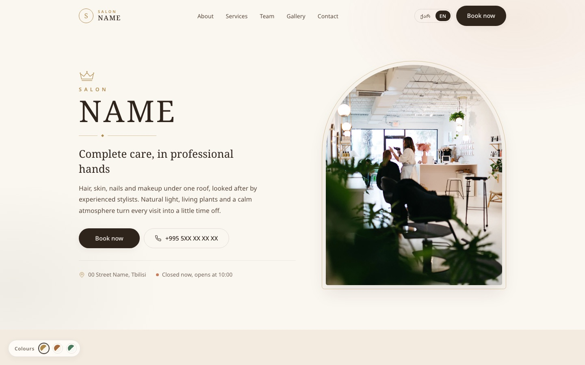
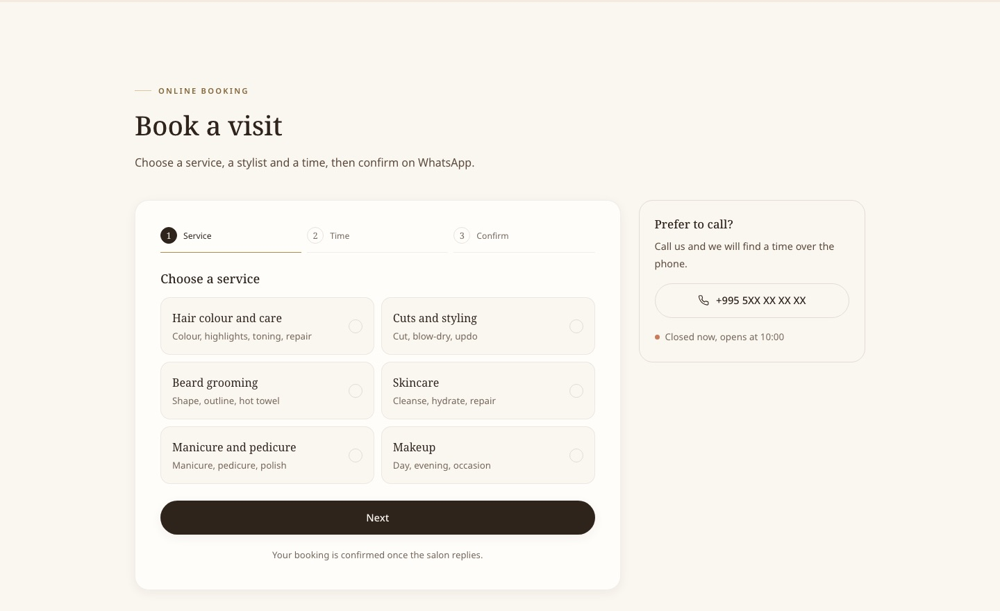
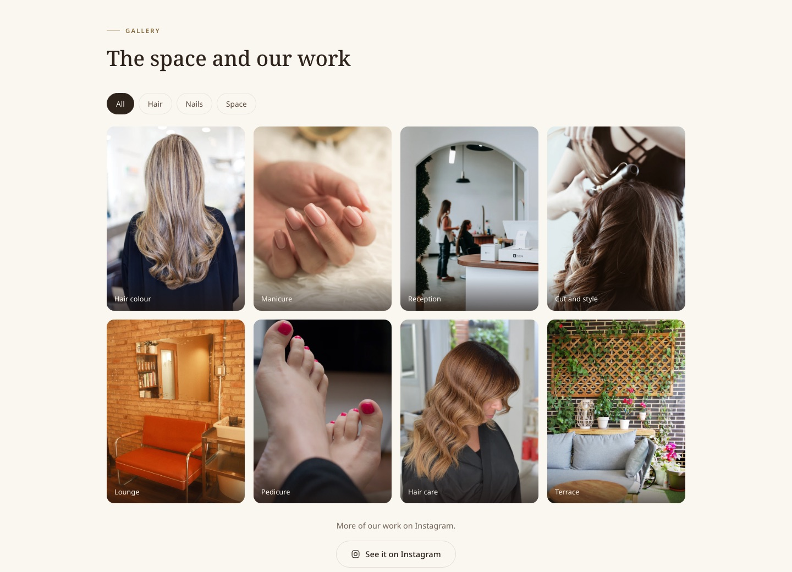
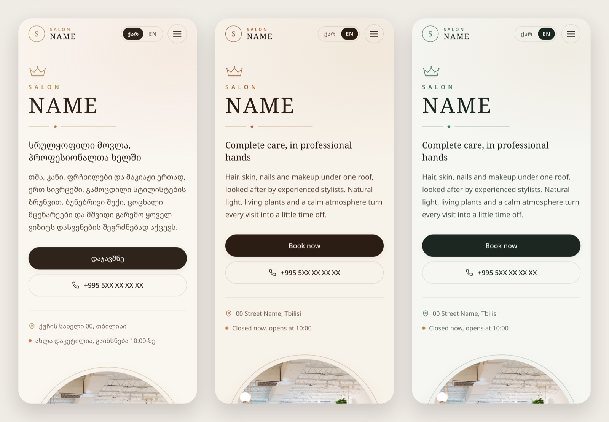

# Salon Website Demo

A bilingual (Georgian / English) website for a beauty salon, built with plain HTML, CSS and
JavaScript. No framework, no build step, no dependencies. Open `index.html` and it works.

**Live demo:** https://protagonistst.github.io/salon-website-demo/



## Features

- **Online booking in three steps.** Service, stylist, date and time, then a confirmation that
  opens WhatsApp with the booking already written. Past time slots are disabled, the phone
  number is validated, and a live preview shows the message before it is sent.
- **Georgian and English.** Every piece of text switches instantly, including the calendar,
  error messages and the WhatsApp message. The choice is remembered.
- **Three colour themes.** Cream and gold, cognac and oak, fern and marble. All text meets the
  WCAG AA contrast ratio in every theme.
- **Tabbed price list** with keyboard support (arrow keys, Home, End).
- **Team section.** "Book" on a team member pre-selects them in the booking form.
- **Gallery** with category filters and a full-screen lightbox (swipe, arrow keys, Esc).
- **Live open / closed status** calculated in Tbilisi time.
- **Reviews, FAQ accordion, map and contact section.**
- **Mobile first.** Sticky booking bar on phones, animated menu, tested down to 320 px wide.
- **Accessible.** Skip link, visible focus, ARIA tabs and dialog, reduced-motion support,
  alt text in both languages.
- **Search ready.** Meta description, Open Graph preview image, and Schema.org `BeautySalon`
  structured data.

| Booking | Gallery |
|---|---|
|  |  |



## Try it with a link

Add these to the address to open a specific look:

| Parameter | Values | Example |
|---|---|---|
| `lang` | `ka`, `en` | `?lang=en` |
| `theme` | `a`, `b`, `c` | `?lang=en&theme=c` |

## Project structure

```
salon-website-demo/
├── index.html            Page markup
├── 404.html              "Page not found" page
├── assets/
│   ├── css/style.css     All styles, including the three themes
│   ├── js/i18n.js        All text, in Georgian and English
│   ├── js/main.js        Behaviour: booking, menu, tabs, gallery, language, themes
│   ├── img/              Photos (WebP)
│   ├── favicon.svg
│   └── og-image.jpg      Link preview image
├── screenshots/          Images used in this README
├── CREDITS.md            Photo and font credits
└── LICENSE
```

## Run it locally

Any static file server works. With Python:

```bash
python3 -m http.server 8000
```

Then open http://localhost:8000.

## Make it your own

| What | Where |
|---|---|
| Text in either language | `assets/js/i18n.js` (edit both `ka` and `en`) |
| WhatsApp number, opening hours, time zone | `CONFIG` at the top of `assets/js/main.js` |
| Colours | `:root` and `:root[data-theme="b"]`, `"c"` at the top of `assets/css/style.css` |
| Photos | `assets/img/`, keeping the same file names and proportions |
| Phone, email, address, map | `index.html` |

## Credits

Photos from [Unsplash](https://unsplash.com), used under the Unsplash License. The salon, team
and reviews are fictional. See [CREDITS.md](CREDITS.md) for every photographer.

## License

Code: [MIT](LICENSE). Photos: Unsplash License.

Design and development by [Beka Lominadze](https://github.com/Protagonistst).
